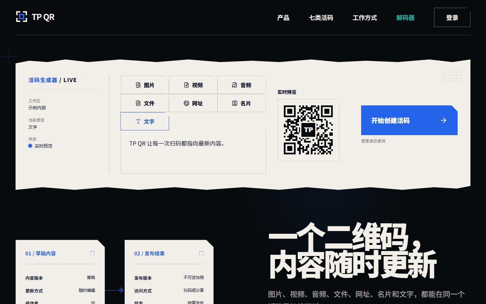
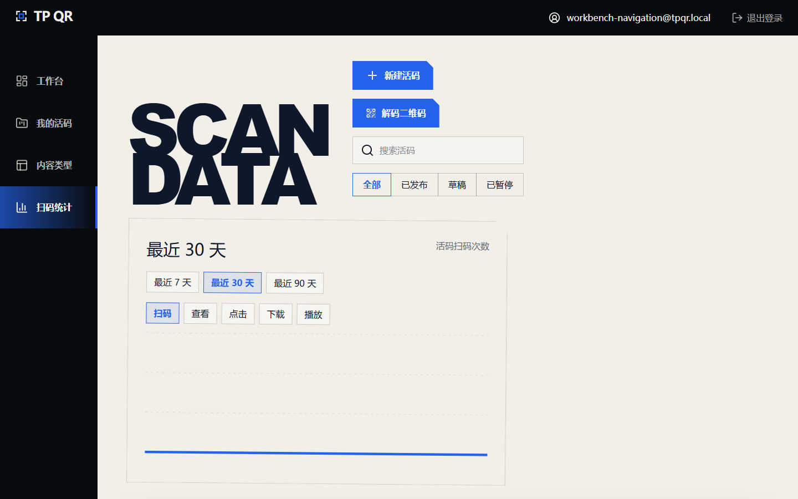
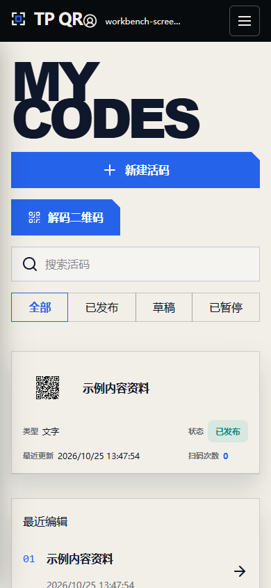

# TP QR CN

TP QR CN is the independent mainland/Alibaba Cloud implementation of TP QR.
It creates dynamic QR codes whose stable URL can be republished with new
content. This repository is intentionally separate from the Cloudflare
implementation: [TPB003/TP_QRCODE](https://github.com/TPB003/TP_QRCODE).

## Homepage

[Open TP QR](https://tpqrcode.xyz/)

[](https://tpqrcode.xyz/)

[View the source on GitHub](https://github.com/TPB003/TP_QRCODE_CN)

The screenshot contains only fictional, reproducible demo content. Production
data, personal QR codes, and generated reports are never committed.

## Features

- Seven dynamic content types: image, video, audio, file, URL, contact (vCard),
  and text.
- Email verification-code login and GitHub login with verified-email account
  linking. Google OAuth backend support is retained for later re-enabling, but
  its current UI entry is intentionally hidden.
- An authenticated dashboard with separate overview, code list, content type,
  and account analytics views. New accounts see a clear empty state, code
  details become readable cards on mobile, and the create dialog closes with
  Escape. Editor, versions, analytics, settings, and decoder keep direct
  navigation back to the workbench.
- Draft editing, readable content previews, revision checks, immutable
  publishing, and QR style controls. The editor keeps the QR image and the
  current scan-result page visible together, including an in-place preview of
  validated URL redirects. Unsaved style changes warn before leaving;
  publishing and code deletion use in-app confirmation dialogs.
- Browser-generated PNG, SVG, WEBP, and JPG QR downloads, including optional
  frame text in the exported image.
- Persistent local media storage on Aliyun by default, with optional private
  OSS storage. Both use the same API checks for MIME, file signature, size,
  ownership, and download name.
- Public content pages that adapt naturally to each content type, plus a QR
  decoder for camera/image input, URLs, text, vCards, and TP QR slugs, with a
  bundled image-decoding fallback when native QR detection is unavailable.
- Published URL codes redirect directly to validated HTTP(S) destinations;
  other content types stay on their public content page.
- Idempotent scan, view, click, download, and play events with rate limits.
- Per-code and account-wide analytics with 7, 30, and 90 day ranges.

## User workflow

```text
login → workbench (overview/codes/types/analytics) → create or edit a code
      → review QR and live scan-result previews → confirm publish → render/download QR
      → scan URL code and redirect / open other public content pages
      → download/share → republish
```

## Workbench navigation

The workbench keeps the selected dashboard view visible in its navigation.
Each code links to its editor, versions, scan analytics, and settings. On small
screens, code details remain visible without a sideways-scrolling table. The
decoder provides links back to the workbench and home.

[](assets/open/workbench-navigation.png)

[](assets/open/workbench-mobile-codes.png)

[Editor preview](assets/open/workbench-editor.png) · [Published public content](assets/open/public-content-text.png)

```text
editor ↔ versions / scan analytics / settings → decoder → workbench
```

## Architecture

The application is a single-origin Node/Hono service behind Caddy:

```text
browser ── HTTPS ──> Caddy ── /api/* ──> Node 22 + Hono
                         └─ static ──> Vite dist
                                      ├─ SQLite /data/tpqr/tpqr.sqlite
                                      └─ persistent local assets (/data/tpqr/assets)
                                           └─ optional private Aliyun OSS
```

The shared packages hold the content, API, QR, and UI contracts. Published
versions are immutable and all public asset reads are authorized by the API.
See [`docs/architecture.md`](docs/architecture.md).

```text
apps/web/                 React/Vite browser application
apps/api/                 Node.js 22/Hono API
packages/domain/          API and version contracts
packages/content/         seven content models and validators
packages/qr/              rendering, download, and decoding primitives
packages/ui/              visual tokens and reusable interface primitives
infra/aliyun/             Docker Compose, Caddy, Dockerfile, env template
infra/database/           repeatable SQLite migrations and local seed
tests/                    unit, integration, browser, security, fixtures
docs/                     architecture, testing, security, deployment
scripts/                  fixtures and open-source boundary checks
assets/open/              small redistributable assets only
```

## Requirements

- Node.js 22.18 or newer
- npm 10 or newer
- Chrome/Chromium for browser tests
- Docker Desktop (optional, for the gateway smoke test)

## Local development

```powershell
git clone https://github.com/TPB003/TP_QRCODE_CN.git
Set-Location TP_QRCODE_CN
npm ci
Copy-Item .env.example .env
npm run setup:local
npm run dev
```

The Vite app runs at `http://127.0.0.1:5173`; the API runs at
`http://127.0.0.1:8787`. Local authentication uses the fixed development code
`123456` and never calls an external mail service. The local database and
assets are stored below ignored `tmp/` paths.

Useful commands:

```powershell
npm run db:migrate:local
npm run db:seed:local
npm run dev:client
npm run dev:api
npm run build
npm run preview
```

## Configuration

Use `.env.example` for local values and
[`infra/aliyun/env.example`](infra/aliyun/env.example) as the production
server template. Never commit `.env`, `.dev.vars`, an ECS address, an OSS
bucket name, OAuth secrets, or a Resend key.

| Variable | Purpose |
| --- | --- |
| `ENVIRONMENT` | `development`, `test`, staging, or `production` |
| `TPQR_DOMAIN` | Hostname served by the production Caddy gateway |
| `APP_ORIGIN` | Browser/API origin and safe redirect origin |
| `PUBLIC_QR_ORIGIN` | Origin encoded into newly generated QR links |
| `TPQR_DATABASE_PATH` | SQLite file path; production defaults to `/data/tpqr/tpqr.sqlite` |
| `TPQR_ASSET_PATH` | Persistent local asset path; production defaults to `/data/tpqr/assets` |
| `AUTH_DELIVERY_MODE` | `dev` locally; `resend` in production |
| `AUTH_TEST_CODE` | Development-only fixed code; never set in production |
| `RESEND_API_KEY`, `RESEND_FROM_EMAIL` | Production verification-code delivery |
| `AUTH_GITHUB_CLIENT_ID`, `AUTH_GITHUB_CLIENT_SECRET` | GitHub App login |
| `AUTH_OAUTH_CALLBACK_ORIGIN` | OAuth callback origin |
| `OSS_REGION`, `OSS_BUCKET`, `OSS_ACCESS_KEY_ID`, `OSS_ACCESS_KEY_SECRET`, `OSS_ENDPOINT` | Optional private OSS configuration; leave the four core values blank to use local storage |
| `SESSION_COOKIE_SECRET` | Required production-only deployment secret (32+ characters) |

Production must use HTTPS, Resend, a verified sender domain, and no
`AUTH_TEST_CODE`. GitHub callback for the production domain is:

```text
https://replace-with-your-domain/api/auth/github/callback
```

## Maintainer CLI

The dependency-free Node 22 CLI is invoked through npm and never prints
secrets or changes registrar DNS:

```powershell
npm run tpqr -- doctor
npm run tpqr -- local setup
npm run tpqr -- check
npm run tpqr -- domain inspect tpqrcode.xyz
npm run tpqr -- oauth check
npm run tpqr -- deploy --environment staging --config tmp/env.staging --dry-run
npm run tpqr -- release verify
```

Production deployment requires an ignored configuration and an explicit
confirmation flag. See [`docs/cli.md`](docs/cli.md).

## Docker Compose / Alibaba Cloud

The stack contains a migration job, Node API, and Caddy gateway. The multi-stage
Dockerfile builds the browser bundle inside the gateway image, so no generated
`dist/` directory is required on the host:

```powershell
Copy-Item .env.example .env
# replace placeholders in .env before a real deployment
npm run build
docker compose -f infra/aliyun/docker-compose.yml -f infra/aliyun/docker-compose.local.yml up --build
```

The local gateway listens on `http://127.0.0.1:8080`. On Ubuntu 24.04 ECS,
keep `.env` mode 600, expose only 80/443, and keep port 8787 internal. Uploaded
assets persist on the host under `/opt/tpqr/data/assets`; private OSS with a
least-privilege RAM user is optional. Caddy terminates HTTPS
after the ICP-approved domain points to the ECS instance. The repository does
not perform DNS changes or contain production credentials.

After one-time server baseline and protected-environment setup, a successful
CI run on `main` can trigger an immutable image release with API and public QR
smoke checks. Production deployment remains disabled until that setup is
verified; see the release procedure in the deployment guide.

See [`docs/deployment-aliyun.md`](docs/deployment-aliyun.md) for backups,
rollback, GitHub Actions releases, Resend, GitHub App, optional OSS, and server hardening guidance.
## Testing and release gate

From a clean checkout:

```powershell
npm ci
npm run setup:local
npm run check:all
npm run check:opensource
git diff --check
```

`check:all` covers lint, strict type checking, unit tests, SQLite/Hono
integration tests, security tests, production build, and Chromium desktop and
mobile browser tests. Browser viewports include 1440×900, 390×844, and
375×812. CI never connects to real ECS, OSS, Resend, OAuth providers, or a
production database. See [`docs/testing.md`](docs/testing.md).

## Documentation sync rule

Every user-visible change must update the corresponding documentation in the
same pull request:

- Update Features and workflow when behavior changes.
- Update the homepage screenshot when the homepage or navigation changes.
- Update CLI docs when commands change.
- Update README and example files when environment variables change.
- Update deployment/auth docs when domains, storage, or login changes.
- For an internal-only refactor, state in the pull request that README review
  found no user-facing update necessary.

The pull request template contains the same checklist.

## Limitations

This edition starts with an empty SQLite database and does not import data from
the Cloudflare edition. Teams, billing, notifications, and super-admin
features are outside the MVP. Mainland availability depends on completed ICP
filing and the network/provider path; this project does not promise universal
network reachability.

## Contributing and security

Read [`CONTRIBUTING.md`](CONTRIBUTING.md), [`CODE_OF_CONDUCT.md`](CODE_OF_CONDUCT.md),
and [`SECURITY.md`](SECURITY.md) before opening a pull request. Report
vulnerabilities privately; do not publish exploit payloads in issues.

## License

MIT License. See [`LICENSE`](LICENSE).
